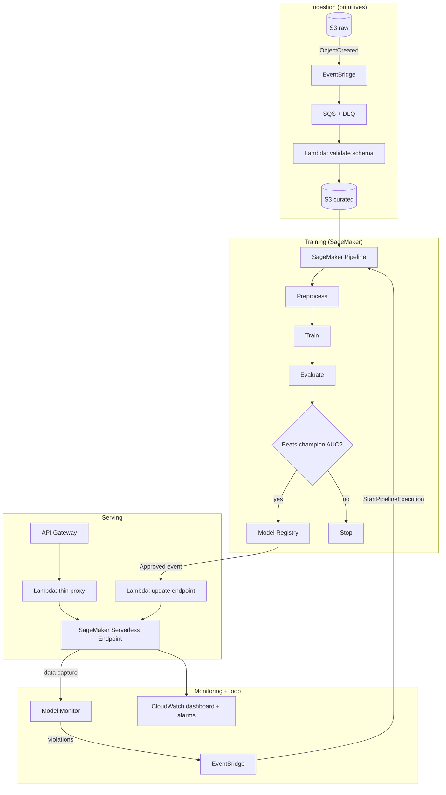

# aws-mlops-platform

A portfolio-grade **MLOps reference platform** on AWS where the *infrastructure is the deliverable*. The model is deliberately trivial (Telco customer churn, XGBoost, ~78% AUC is fine); the engineering lives in the pipeline, the IaC, the CI/CD, and the **closed drift → retrain loop**.

**One command to a working platform:** `cdk deploy --all` into a clean account stands up ingestion, training, a champion/challenger promotion gate, serverless inference, and drift monitoring.

## Architecture



## The closed loop

1. Traffic hits the API; the endpoint's **Data Capture** logs request/response to S3.
2. **Model Monitor** compares captured traffic against a baseline from training data on a schedule.
3. A violation emits a `CompletedWithViolations` event → EventBridge → Lambda → `StartPipelineExecution`.
4. The pipeline trains a **challenger**; a `ConditionStep` registers it **only if its test AUC beats the current champion's**.
5. Registry approval (auto in dev, manual in prod) → EventBridge → deploy Lambda updates the serverless endpoint. Loop closed.

## Repo map

| Path | What |
|---|---|
| `infra/` | CDK app: `Data`, `Ingestion`, `Training`, `Registry`, `Serving`, `Monitoring` stacks, split by lifecycle/blast radius |
| `src/common/schema.py` | Single source of truth: pydantic schema shared by ingestion validation and the inference API |
| `src/pipeline/` | SageMaker Pipeline definition + preprocess/evaluate scripts |
| `src/ingestion/`, `src/serving/` | Lambda handlers (validate, proxy, endpoint deploy) |
| `scripts/` | Monitor setup, drift-traffic demo |
| `.github/workflows/` | CI (lint/test/synth) and OIDC-federated deploy (dev → manual gate → prod) |

## Quickstart

```bash
make install                 # deps
make lint test               # local checks
cd infra && cdk bootstrap    # once per account/region
make deploy ENV=dev          # all six stacks

# 1. Ingest: drop the Telco CSV into the raw bucket -> validated rows land curated
aws s3 cp telco.csv s3://<raw-bucket>/telco.csv

# 2. Train: upsert + run the pipeline (registers the first champion)
python src/pipeline/pipeline.py --pipeline-name churn-training-pipeline-dev \
  --role-arn <PipelineRoleArn output> --curated-bucket <curated> \
  --artifacts-bucket <artifacts> --model-package-group churn-model-group --start

# 3. Serve: approval event auto-deploys the endpoint; then
curl -X POST <ApiUrl> -H "x-api-key: <key>" -H "Content-Type: application/json" -d @sample.json

# 4. Close the loop: baseline + schedule, then send drifted traffic
python scripts/setup_monitor.py --endpoint churn-serverless-dev ...
python scripts/send_drift_traffic.py --url <ApiUrl> --api-key <key> -n 200
```

## Decisions log

| Decision | Choice | Rationale |
|---|---|---|
| Serving | SageMaker Serverless Inference | Scales to zero (~$0 idle); registry-native; cold-start latency accepted and named |
| Managed vs. primitive | Mix | SageMaker where ML lineage matters (training/registry/monitor); primitives (S3/SQS/Lambda) where it doesn't |
| Orchestration | SageMaker Pipelines | Step lineage + caching for free vs. hand-rolled Step Functions |
| Promotion | ConditionStep vs. champion AUC | Challenger must beat champion; no silent regressions |
| IaC | CDK (Python) | Type-checked infra, same language as the ML code |
| CI auth | GitHub OIDC | No long-lived keys in secrets |
| Pipeline/monitor via SDK | Not CloudFormation | SageMaker Pipelines are versioned documents; Monitor needs a live endpoint. CDK owns the IAM + wiring |

## Security & cost posture

- Per-component IAM roles (validation Lambda, pipeline, proxy, deploy Lambda) — no shared god role. `InvokeEndpoint` is never exposed directly; only API Gateway with API-key auth is.
- All buckets: block-public, SSE-KMS, TLS-only, versioned.
- Everything scales to zero when idle; standing cost is S3 pennies + logs (14-day retention). Budget alarm at $20/mo as a tripwire.
