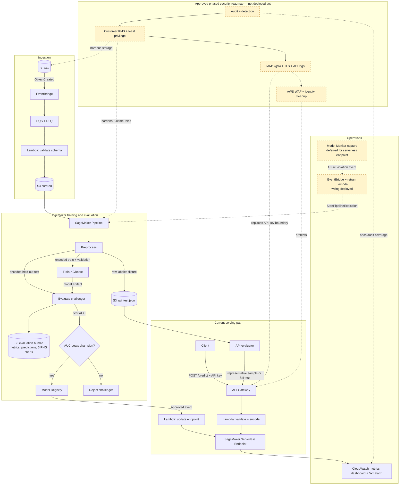

# aws-mlops-platform

A portfolio-grade **MLOps reference platform** on AWS where the *infrastructure is the deliverable*. The model is deliberately simple (Telco customer churn with XGBoost); the engineering lives in ingestion, reproducible evaluation, champion/challenger promotion, infrastructure as code, CI/CD, and low-cost serverless inference.

`cdk deploy --all` creates the six infrastructure stacks. The SageMaker Pipeline is then upserted through the SDK-driven pipeline command because its definition depends on live Model Registry state. The current dev environment has completed ingestion, training, held-out evaluation, model registration, serverless deployment, and API inference.

## Architecture



Solid runtime arrows describe the current dev data path. Dashed arrows and
yellow nodes are deferred or approved future work. In particular, the retrain
wiring exists, but built-in SageMaker Model Monitor capture is not active because
serverless endpoints do not support `DataCaptureConfig`.

## Current operational loop

1. A raw CSV upload is validated before accepted rows are written to curated S3.
2. The pipeline creates deterministic training, validation, held-out test, and raw API-verification fixtures.
3. `Evaluate` scores the challenger on unseen test data, writes the JSON/CSV/PNG report bundle, and exposes test AUC to the promotion gate.
4. A `ConditionStep` registers the challenger only when its test AUC is strictly greater than the current approved champion's AUC.
5. Registry approval (automatic in dev, manual in prod) triggers the deployment Lambda, which creates or updates the SageMaker serverless endpoint.
6. API Gateway and the proxy Lambda validate and encode `/predict` requests before invoking the endpoint. The API evaluator can replay the labeled held-out fixture through this deployed serving path.

The drift-to-retrain leg is intentionally incomplete today. CloudWatch provides
endpoint invocations, latency, and error visibility, and the monitoring stack
contains the violation-event-to-pipeline wiring. However, the serverless
endpoint cannot produce SageMaker's built-in capture stream, so no Model Monitor
schedule is supplying violation events. A future phase must choose another
capture design or provisioned inference before calling this a closed automated
drift loop.

## Repo map

| Path | What |
|---|---|
| `infra/` | CDK app: `Data`, `Ingestion`, `Training`, `Registry`, `Serving`, `Monitoring` stacks, split by lifecycle/blast radius |
| `src/common/schema.py` | Single source of truth: pydantic schema shared by ingestion validation and the inference API |
| `src/pipeline/` | SageMaker Pipeline definition + preprocess/evaluate scripts |
| `src/ingestion/`, `src/serving/` | Lambda handlers (validate, proxy, endpoint deploy) |
| `scripts/` | API evaluation plus optional monitor/drift utilities for a compatible capture architecture |
| `wiki/` | LLM-maintained, interlinked knowledge base for the platform |
| `.github/workflows/` | CI (lint/test/synth) and OIDC-federated deploy (dev → manual gate → prod) |

## Quickstart

```bash
cp .env.example .env         # fill in stack outputs after deploy; source with: set -a && source .env && set +a
make install                 # deps
make lint test               # local checks
cd infra && cdk bootstrap    # once per account/region
make deploy ENV=dev          # all six stacks

# 1. Ingest: drop the Telco CSV into the raw bucket -> validated rows land curated
aws s3 cp telco.csv s3://<raw-bucket>/telco.csv

# 2. Train: upsert + run the pipeline (registers the first champion)
python src/pipeline/pipeline.py --pipeline-name churn-training-pipeline-dev \
  --role-arn <PipelineRoleArn output> --curated-bucket <curated> \
  --artifacts-bucket <artifacts> --model-package-group churn-model-group --start

# 3. Serve: approval event auto-deploys the endpoint; then
curl -X POST <ApiUrl> -H "x-api-key: <key>" -H "Content-Type: application/json" -d @sample.json

# 4. Inspect the execution's report bundle in the artifacts bucket, then run
# the API verification command shown in the next section.
```

Do not run `setup_monitor.py` against the current serverless endpoint expecting
built-in request/response capture. That path requires a compatible alternative
capture design or a provisioned endpoint.

## Model evaluation reports

Each `Evaluate` ProcessingStep scores a model on the held-out test split. It
stores an execution-scoped report bundle under
`s3://<artifacts-bucket>/evaluations/<UTC-start-timestamp>/<execution-id>/`:
the existing `evaluation.json` (AUC and Model Registry input), `metrics.json`,
`predictions.csv`, and PNG confusion-matrix, ROC, precision-recall,
calibration, and score-distribution charts. The confusion matrix uses the same
`0.50` cutoff as the `/predict` API: a probability of `0.50` or above is
classified as churn.

After an endpoint deployment, validate the public serving path against the
same raw, labeled held-out records. The default is a deterministic,
class-balanced sample of 25 records; use `--all` for the full test split.

```bash
API_URL=https://<api-id>.execute-api.us-east-1.amazonaws.com/dev/predict \
API_KEY="$API_KEY" \
python scripts/evaluate_api.py \
  --pipeline-execution-arn <pipeline-execution-arn>

# Full held-out test-set API evaluation (more endpoint invocations):
API_URL=https://<api-id>.execute-api.us-east-1.amazonaws.com/dev/predict \
API_KEY="$API_KEY" \
python scripts/evaluate_api.py \
  --pipeline-execution-arn <pipeline-execution-arn> --all
```

The evaluator discovers the `api_test` fixture output of that execution,
checks that every API response obeys the probability and `0.50` classification
contract, and prints labeled endpoint metrics. The offline `Evaluate` report
remains the source of truth for model promotion.

## LLM Wiki

The repository also includes a local-first LLM Wiki. `wiki/raw/` stores immutable source material; `wiki/pages/` stores the maintained synthesis; `wiki/index.md` and `wiki/log.md` provide navigation and history; and `wiki/SCHEMA.md` defines the agent's operating contract.

```bash
make wiki-search Q="SageMaker permissions"
make wiki-ingest SOURCE=/path/to/article.md TITLE="Article title"
make wiki-lint
```

The helper is intentionally deterministic and does not call an LLM. It handles source registration, page scaffolding, index rebuilding, full-text search, operation logging, and health checks so an LLM can focus on reading, synthesis, and cross-referencing.

## Decisions log

| Decision | Choice | Rationale |
|---|---|---|
| Serving | SageMaker Serverless Inference | Scales to zero (~$0 idle); registry-native; cold-start latency accepted and named |
| Managed vs. primitive | Mix | SageMaker where ML lineage matters (training and registry); primitives (S3/SQS/Lambda) for transport and integration |
| Orchestration | SageMaker Pipelines | Step lineage + caching for free vs. hand-rolled Step Functions |
| Promotion | ConditionStep vs. champion AUC | Challenger must beat champion; no silent regressions |
| IaC | CDK (Python) | Type-checked infra, same language as the ML code |
| CI auth | GitHub OIDC | No long-lived keys in secrets |
| Pipeline via SDK | Not CloudFormation | SageMaker Pipelines are versioned documents and resolve live champion state; CDK owns the supporting IAM |
| Serverless monitoring | Defer built-in capture | Keep the endpoint near-zero idle cost; choose another capture design before enabling Model Monitor |
| Security rollout | Phase-by-phase | Audit and guardrails precede KMS, least privilege, IAM/SigV4, TLS, and WAF changes so failures stay attributable |

## Security and cost posture

Current dev baseline:

- Raw, curated, and artifact buckets block public access, enforce TLS, use
  AWS-managed SSE-KMS encryption, retain versions, and are not public.
- Runtime responsibilities use separate validation, pipeline, proxy, deployment,
  and model roles. The proxy is scoped to invoke only the configured endpoint;
  the pipeline and model roles still use `AmazonSageMakerFullAccess` and are a
  documented hardening gap.
- `/predict` currently requires an API key and is throttled, but the key is not
  strong user authentication. The approved roadmap replaces it with IAM/SigV4.
- CloudWatch currently covers endpoint operations. At the July 12 security
  checkpoint, CloudTrail, GuardDuty, Security Hub, AWS Config, IAM Access
  Analyzer, account-level S3 blocking, and WAF were not enabled.
- Serverless inference has no configured provisioned concurrency, so endpoint
  compute has no standing instance while idle. S3, logs, and other retained AWS
  resources still incur small ongoing charges. The monthly budget is `$20`.

The approved [phased security hardening roadmap](wiki/pages/architecture/phased-security-hardening.md)
adds repository guardrails first, then audit and detection, customer-managed
KMS encryption, least-privilege IAM, IAM/SigV4 API authorization, TLS/logging,
WAF, and operator-identity cleanup. Every phase has its own commit, deployment,
verification, rollback point, and explicit stop before the next phase.
