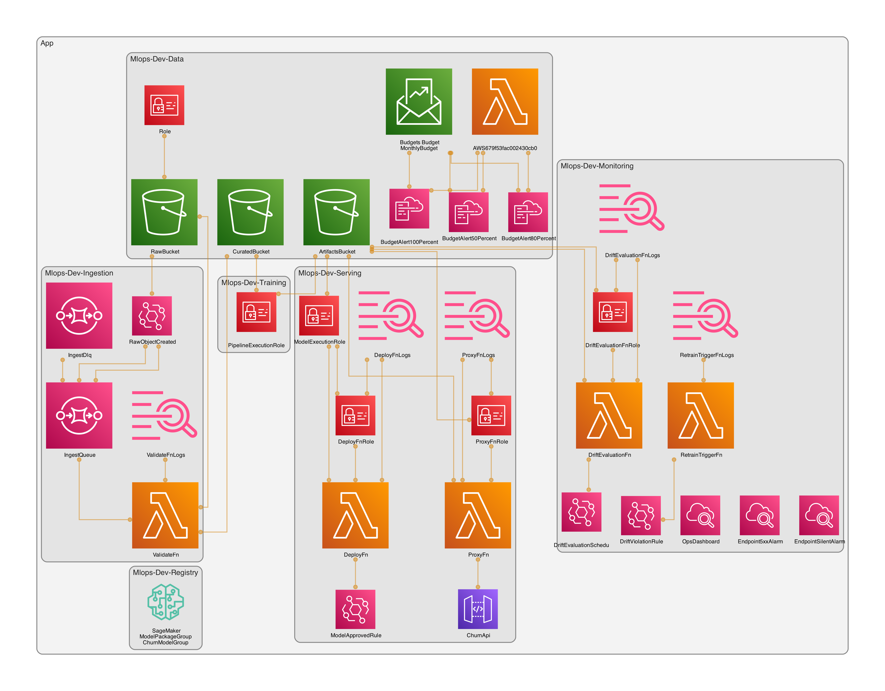
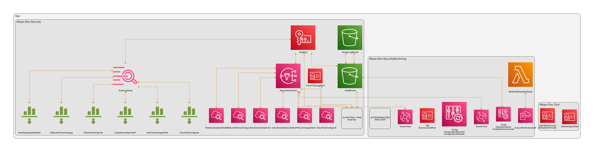

# Generated CDK infrastructure diagrams

## Confirmed

`make diagrams ENV=dev` synthesizes the current CDK app and renders three PNG
files with `cdk-dia` 0.12.3. The dev assembly contains nine stacks. The images
show constructs and references from `infra/cdk.out/tree.json`.

### Complete CDK app

[](../../assets/architecture/cdk-full-dev.png)

### ML platform stacks

This view contains `Data`, `Ingestion`, `Registry`, `Training`, `Serving`, and
`Monitoring`.

[](../../assets/architecture/cdk-platform-dev.png)

### Security and CI/CD stacks

This view contains `Security`, `SecurityMonitoring`, and `Cicd`.

[](../../assets/architecture/cdk-security-cicd-dev.png)

## Synthesis

Use the complete view for inventory and cross-stack reference review. Use the
focused views when resource labels in the complete view become too small. The
Mermaid diagram in the [repository README](../../../README.md) remains the
logical data, model, serving, and drift flow.

These generated views complement the
[resource and permission boundaries](permissions.md). They do not replace the
[phased security status board](phased-security-hardening.md).

## Tensions or open questions

- The images show synthesized desired state. They do not prove that AWS
  deployed a stack or changed a resource.
- The SDK upserts the SageMaker Pipeline after CDK deployment. The pipeline
  steps and promotion behavior are therefore absent from the CDK tree.
- A construct reference shows an infrastructure dependency. It does not prove
  that a runtime event path was exercised.
- `cdk-dia` diagram decorators support TypeScript and JavaScript projects. This
  Python project uses stack filters instead.

## Regeneration

Install Graphviz once, then use the repository target:

```bash
brew install graphviz
make install
make diagrams ENV=dev
```

`DIAGRAM_DIR=/path/to/output` overrides the default
`wiki/assets/architecture` destination. `ENV=prod` produces the equivalent
prod design without deploying it.
